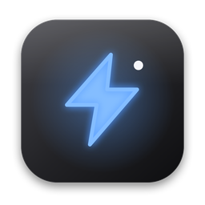
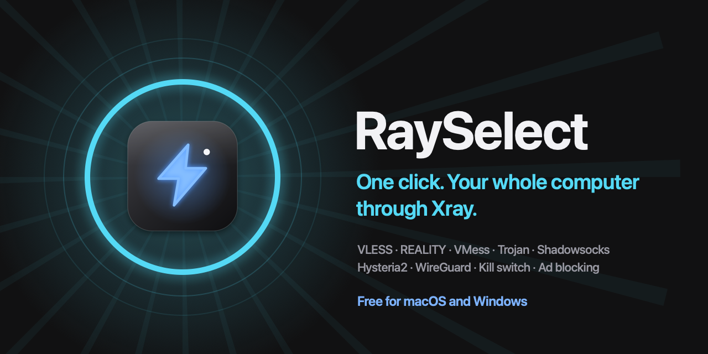

  

<h1 align="center">RaySelect</h1>

<b>One click. Your whole computer through Xray.</b> Free for macOS and Windows.

  
  
  

RaySelect routes your whole computer through Xray with one click: VLESS (REALITY), VMess, Trojan, Shadowsocks, Hysteria2, WireGuard, and subscriptions, with a kill switch, ad and tracker blocking, and anti-censorship options.

**Website:** https://nimakhadivar.github.io/rayselect/ · **All downloads:** [latest release](../../releases/latest)

- macOS: Apple silicon, macOS 11 or later. The first time, if macOS says it can't check the app, open **System Settings → Privacy & Security** and click **Open Anyway** (or run `xattr -cr /Applications/RaySelect.app` in Terminal).
- Windows: Windows 10 or 11, 64-bit. If Windows shows "Windows protected your PC", choose **More info → Run anyway**.

RaySelect does not provide servers. It bundles [Xray-core](https://github.com/XTLS/Xray-core) (Mozilla Public License 2.0).
